# LendLoop

> **Borrow what you need. Lend what you don't.**

A neighborhood tool-lending board: neighbors list tools they're happy to lend, request to borrow each other's for a date range, and get automated notifications and overdue reminders through n8n.

**Stack:** Next.js 16 (App Router) · Clerk · Convex · n8n (self-hosted, Docker) · TypeScript · Tailwind CSS v4

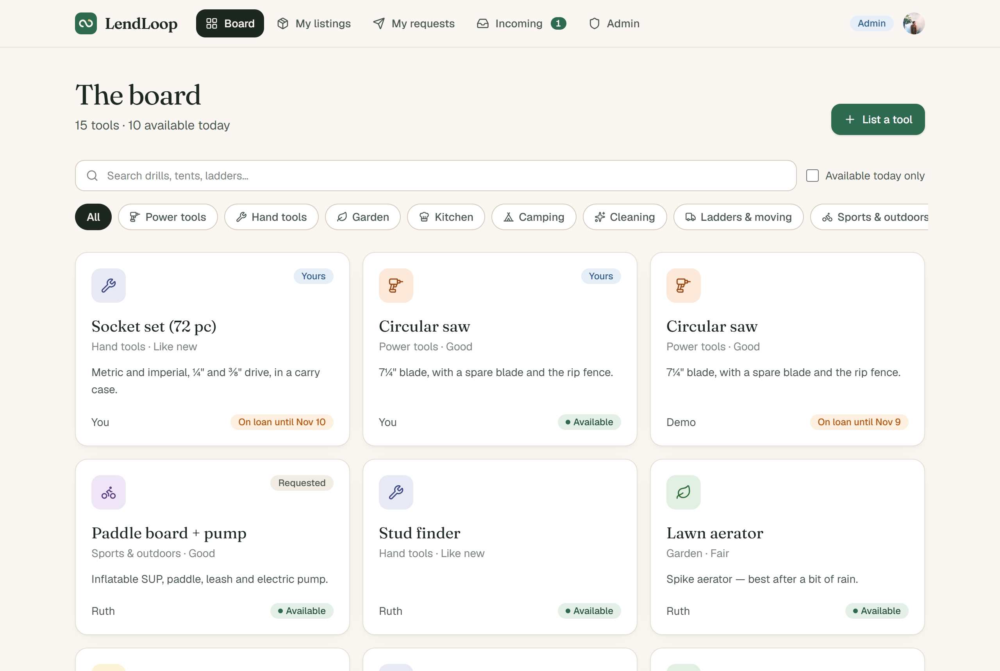

<table>
<tr>
<td width="50%">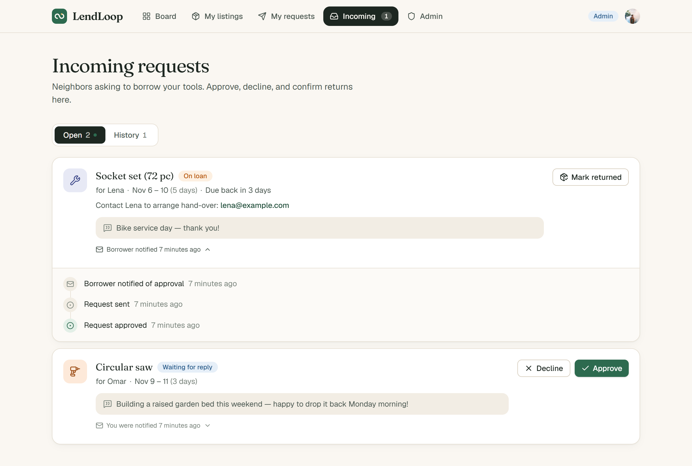<br><sub><b>Incoming requests.</b> Approve or decline. Contact details appear only while a loan is approved. Every loan shows what automation did for it.</sub></td>
<td width="50%">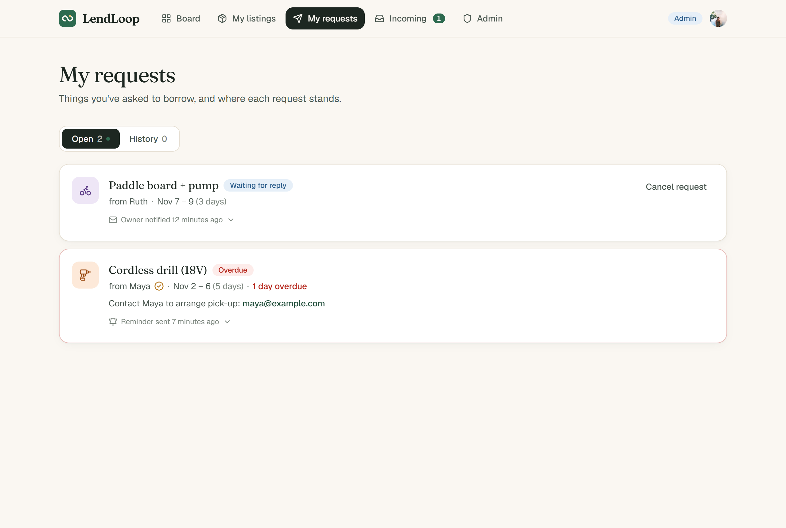<br><sub><b>My requests.</b> Overdue loans are flagged, and the n8n reminder shows up on the loan.</sub></td>
</tr>
<tr>
<td>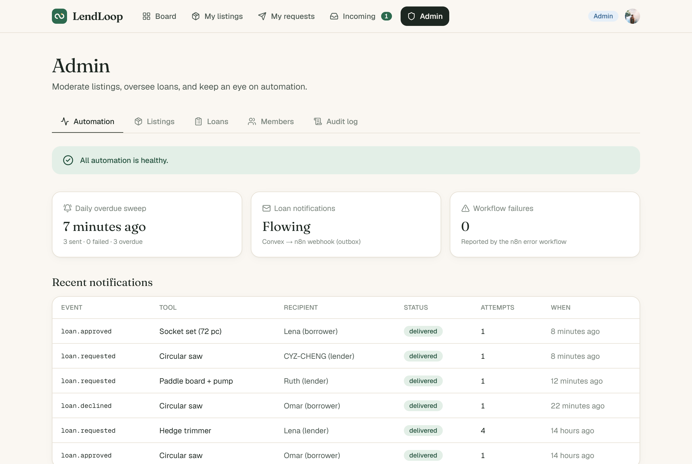<br><sub><b>Admin · Automation.</b> Sweep heartbeat, every outbox delivery with attempt counts, and failures reported by the n8n error workflow.</sub></td>
<td>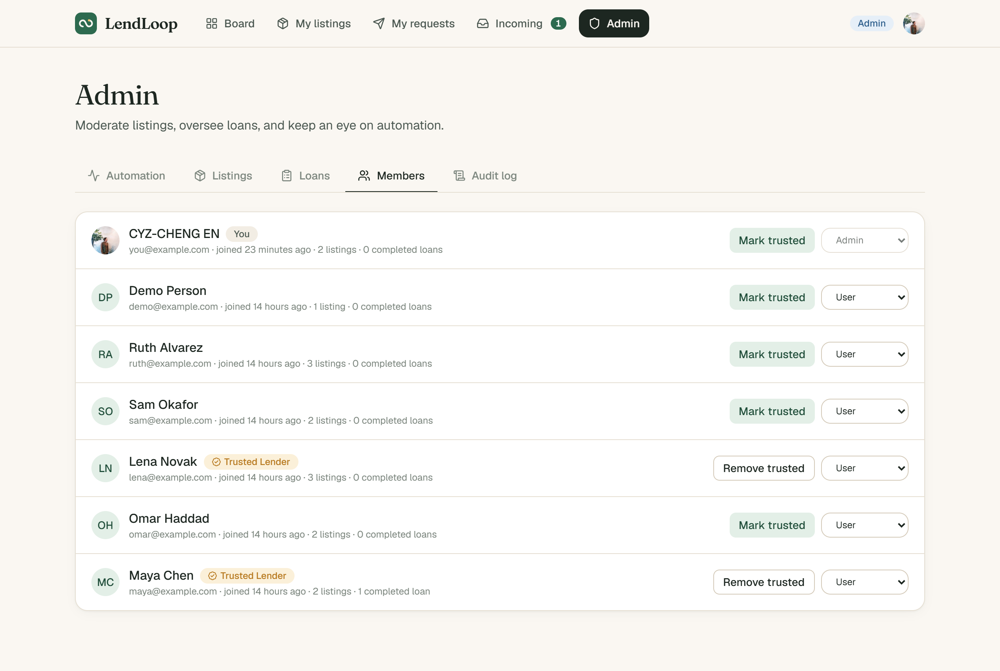<br><sub><b>Admin · Members.</b> Trusted Lender badges and roles, enforced in Convex.</sub></td>
</tr>
<tr>
<td>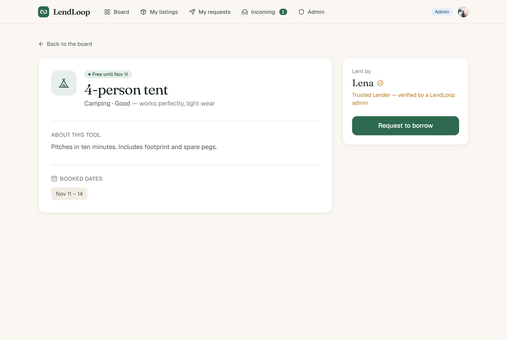<br><sub><b>Tool detail.</b> Live availability and booked dates. Owners are shown by first name only.</sub></td>
<td>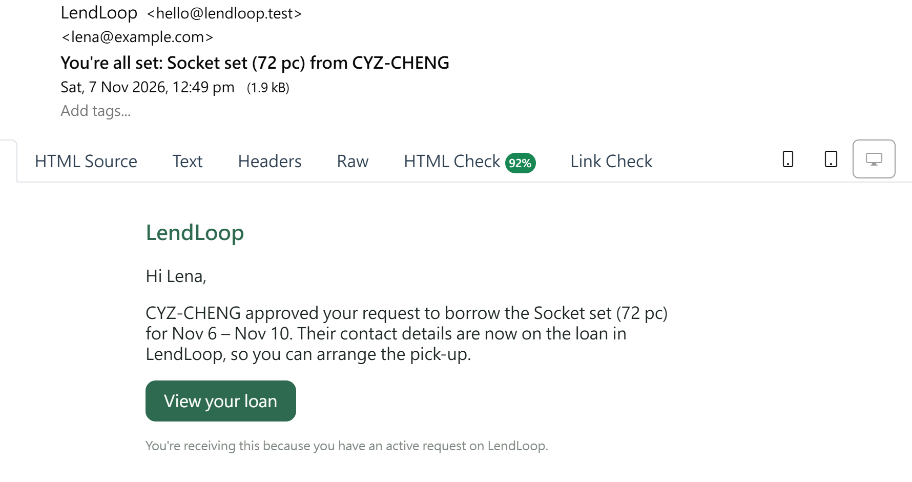<br><sub><b>Email from n8n</b> (captured locally by Mailpit).</sub></td>
</tr>
</table>

<details>
<summary>More: public landing page, listing form, admin loan oversight</summary>

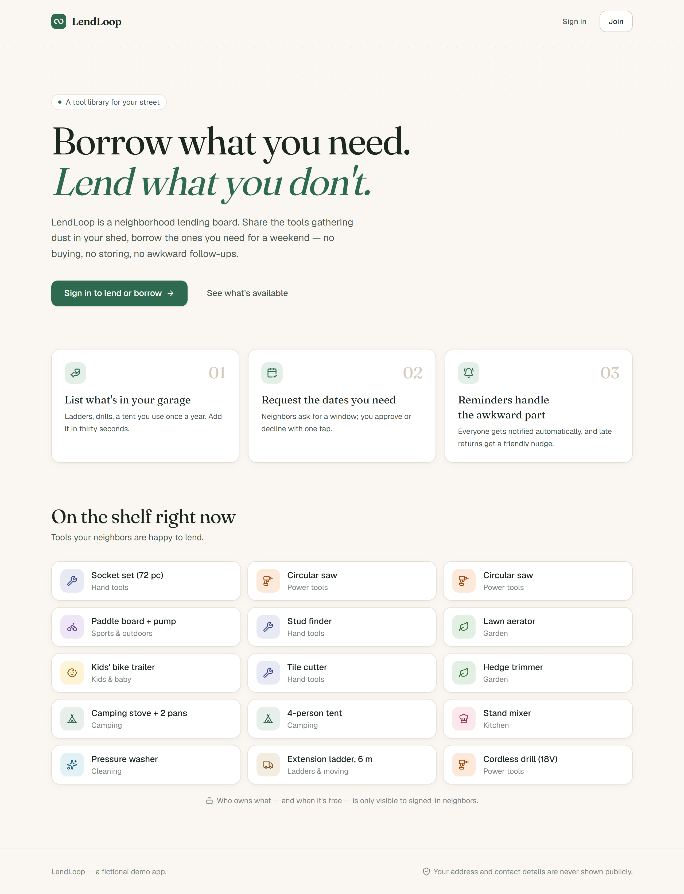
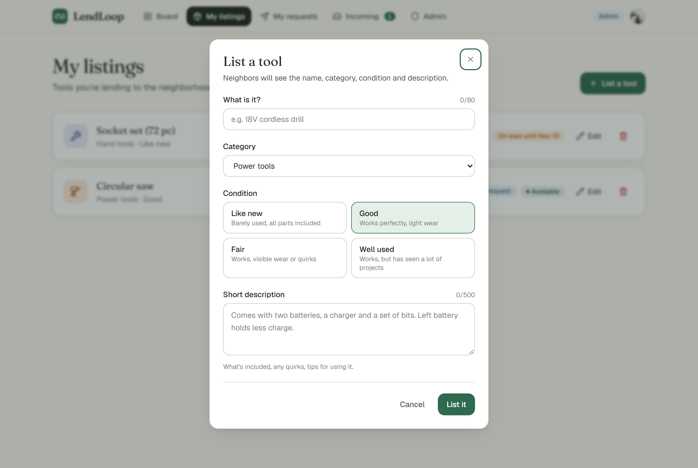
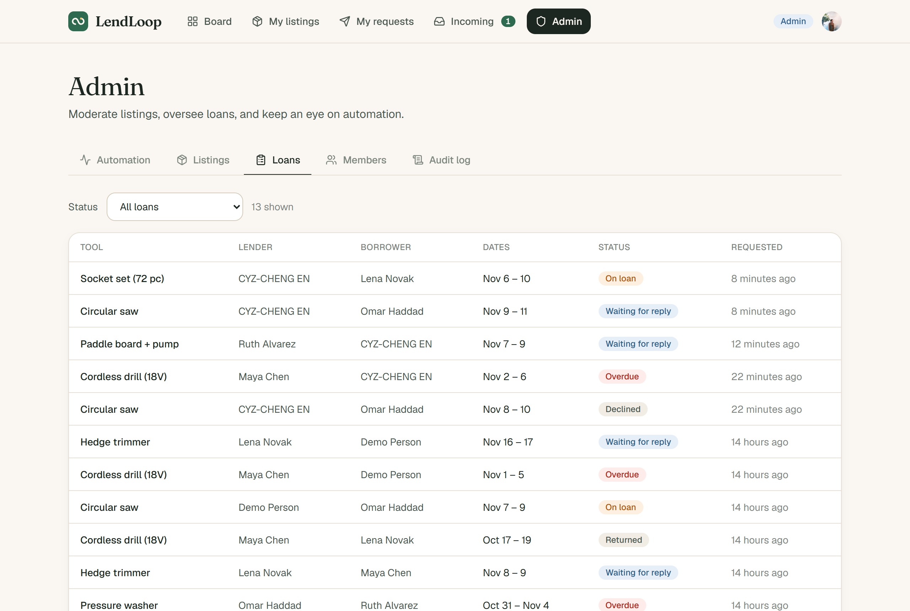

</details>

---

## Contents

1. [What it does](#what-it-does)
2. [Quick start](#quick-start)
3. [Environment variables](#environment-variables)
4. [Architecture](#architecture)
5. [Security and data minimization](#security-and-data-minimization)
6. [Automation: reliability and error handling](#automation-reliability-and-error-handling)
7. [Testing](#testing)
8. [Project layout](#project-layout)
9. [Running this in production](#running-this-in-production)
10. [Trade-offs and known limitations](#trade-offs-and-known-limitations)

---

## What it does

**Public page (`/`)**: tagline, how-it-works, and a read-only list of available tools pulled live from Convex. It shows **name and category only**, with no owner, description, availability or IDs. There's a "Sign in to lend or borrow" button wired to Clerk.

**Signed-in app**

| Page | What you can do |
| --- | --- |
| **Board** `/board` | All tools with live availability (*Available*, *Free until Nov 12*, *On loan until…*, *Overdue*). Filter by category (indexed, server-side) and search. |
| **Tool** `/tools/[id]` | Details, condition, owner's first name with a **Trusted Lender** badge, booked date ranges, and your history with the tool. Request a date range (validated live, re-validated on the server). |
| **My listings** `/me/listings` | Create, edit and delete your own tools, with a count of waiting requests per tool. |
| **My requests** `/me/requests` | Your borrow requests by status; cancel before pick-up. |
| **Incoming** `/me/incoming` | Requests for your tools: approve, decline, mark returned. Nav badge shows how many are waiting. |
| **Admin** `/admin` | Remove any listing (with a reason), view all loans, mark Trusted Lenders, change roles, an **automation health** dashboard, and an audit log. |

**Automation activity on every loan (bonus).** Each loan row shows what the automation last did ("Owner notified 3 min ago", "Reminder sent 2 days ago (2 so far)"). Expanding it shows a full timeline that mixes status changes with notification and reminder events.

**Extras beyond the brief:** approving a request auto-declines overlapping requests and notifies those borrowers; double booking is impossible (checked inside a serializable transaction); per-user rate limits; an admin audit log; a dead-letter queue with a one-click retry; a watchdog that notices when the daily job *stops running* (not just when it fails); Mailpit so every email can be inspected locally; seed data; 34 automated tests.

---

## Quick start

### Prerequisites

- Node.js 20+ (developed on 24)
- Docker Desktop (for n8n, Postgres, Mailpit)
- A free [Clerk](https://clerk.com) application

No Convex account is needed for local development: `npx convex dev` can run a **local Convex backend** on your machine. That also means Convex can reach n8n on `localhost` without a tunnel.

### 1. Install

```bash
git clone <this repo> lendloop && cd lendloop
npm install
```

### 2. Clerk

1. Create an application in the Clerk dashboard and copy the API keys into `.env.local`:
   ```bash
   NEXT_PUBLIC_CLERK_PUBLISHABLE_KEY=pk_test_...
   CLERK_SECRET_KEY=sk_test_...
   ```
2. Dashboard → **Integrations → Convex** → *Activate*. This creates the `convex` JWT template (`aud: "convex"`) that Convex verifies. Copy the **Frontend API URL** shown there (e.g. `https://xxx.clerk.accounts.dev`).

### 3. Convex

```bash
npx convex dev            # first run: choose "local" (or log in for a cloud dev deployment)
# in another terminal:
npx convex env set CLERK_JWT_ISSUER_DOMAIN https://xxx.clerk.accounts.dev
npx convex env set ADMIN_EMAILS you@example.com     # verified emails promoted to admin on first sign-in
```

Leave `npx convex dev` running. It watches `convex/` and pushes functions on save.

### 4. Secrets and n8n

```bash
npm run setup:secrets   # creates n8n/.env with generated keys and sets the matching Convex env vars
npm run n8n:up          # n8n + Postgres + Mailpit
npm run n8n:setup       # imports the SMTP credential + 3 workflows, publishes them, restarts n8n
```

- n8n: <http://localhost:5678>. Create the owner account on first visit; the workflows are already there and published.
- Mailpit: <http://localhost:8025>. Every email n8n sends lands here.

### 5. Run the app

```bash
npm run dev             # http://localhost:3000
```

Sign in, then optionally load demo data:

```bash
npm run seed                                            # 5 neighbors, 12 tools, a few loans (one overdue)
npx convex run seed:involve '{"email":"you@example.com"}' # puts YOU in the story: an incoming request, an active loan, an overdue one (idempotent)
```

### 6. Try the automation

- **Request / approve / decline / return** a loan, and the email shows up in Mailpit within seconds. Expand the loan's activity to see "Owner notified just now".
- **Overdue reminders**: in n8n open *LendLoop · Overdue reminders* → **Execute workflow** (uses the manual trigger; the schedule runs daily at 09:00). Reminders arrive in Mailpit, the loan shows "Reminder sent just now", and *Admin → Automation* shows the run. Run it again and nothing is re-sent (idempotent).
- **Failure path**: `docker stop lendloop-mailpit-1`, then approve something. The webhook fails, Convex retries with backoff, the n8n error workflow reports to *Admin → Automation*, and once you `docker start lendloop-mailpit-1` the retry delivers.

### Useful scripts

| Script | |
| --- | --- |
| `npm run check` | typecheck (app + Convex) → lint → tests |
| `npm test` | Vitest + convex-test |
| `npm run n8n:export` | re-export workflows from n8n into `n8n/workflows/` (strips instance data, fails if a secret appears) |
| `npm run setup:secrets -- --rotate` | rotate both signing keys on both sides |

---

## Environment variables

Secrets live in exactly three places, all outside git: `.env.local` (Next.js), the **Convex deployment env** (`npx convex env set`), and `n8n/.env` (passed to the container). The exported workflow JSON contains **no secrets**. It references the SMTP credential by id and reads signing keys via `$env` at runtime, and `npm run n8n:export` refuses to write a file that contains a secret value.

**Next.js** (`.env.local`; see `.env.example`)

| Variable | Purpose |
| --- | --- |
| `NEXT_PUBLIC_CONVEX_URL` | Convex client URL (written by `npx convex dev`) |
| `NEXT_PUBLIC_CLERK_PUBLISHABLE_KEY` / `CLERK_SECRET_KEY` | Clerk |

**Convex deployment** (declared and typed in `convex/convex.config.ts`)

| Variable | Purpose |
| --- | --- |
| `CLERK_JWT_ISSUER_DOMAIN` | Clerk Frontend API URL; Convex validates JWTs against its JWKS |
| `ADMIN_EMAILS` | Comma-separated bootstrap admins (applied only if Clerk marks the email verified) |
| `APP_URL` | Base URL used for deep links in emails |
| `N8N_LOAN_EVENTS_WEBHOOK_URL` | n8n webhook for loan events |
| `N8N_OUTBOUND_SIGNING_SECRET` | HMAC key: Convex **signs** → n8n verifies |
| `N8N_INBOUND_SIGNING_SECRET` | HMAC key: n8n **signs** → Convex verifies |

**n8n** (`n8n/.env`; see `n8n/.env.example`)

| Variable | Purpose |
| --- | --- |
| `N8N_ENCRYPTION_KEY` | Encrypts stored n8n credentials |
| `N8N_DB_PASSWORD` | Postgres password for n8n |
| `LENDLOOP_CONVEX_SITE_URL` | Convex HTTP actions base URL as seen from the container (`http://host.docker.internal:3211` locally) |
| `LENDLOOP_OUTBOUND_SIGNING_SECRET` | = Convex `N8N_OUTBOUND_SIGNING_SECRET` |
| `LENDLOOP_INBOUND_SIGNING_SECRET` | = Convex `N8N_INBOUND_SIGNING_SECRET` |
| `LENDLOOP_SMTP_*` | Used once, at setup, to create the encrypted SMTP credential (default: Mailpit) |
| `LENDLOOP_MAIL_FROM`, `LENDLOOP_OPS_EMAIL`, `TIMEZONE` | Sender, ops alert recipient, schedule timezone |

---

## Architecture

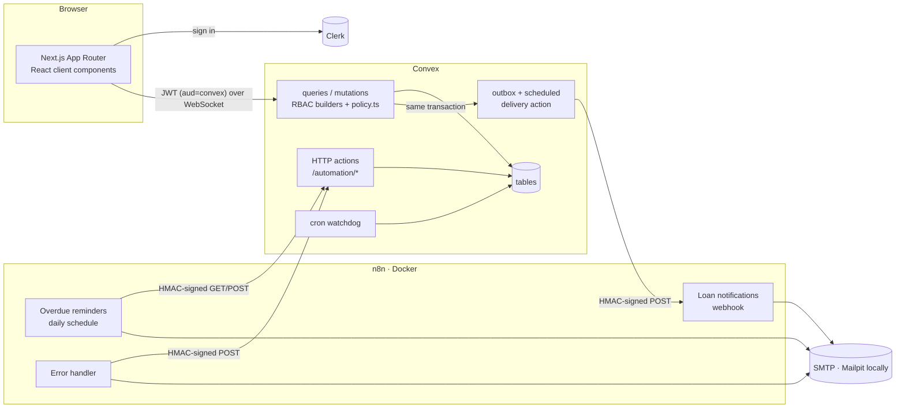

### Why this shape

- **Convex is the single source of truth and the only enforcement point.** Every public function is built with `userQuery` / `userMutation` / `adminQuery` / `adminMutation` (`convex/lib/functions.ts`), which resolve the caller from the verified JWT before the handler runs. Resource rules ("only the owner can edit") live in one pure module, `convex/lib/policy.ts`, which is unit-tested as a matrix. The Next.js layer has an optimistic `auth.protect()` gate for UX only.
- **Derived state is never stored.** "On loan", "scheduled" and "overdue" are computed from `status = approved` plus dates, so they can't drift. Queries take `today` as an argument because Convex queries must be deterministic.
- **n8n does delivery, not business logic.** Convex decides *what* happened and *who* should hear about it; n8n decides *how* to tell them. Swapping email for Slack is a workflow change with no app deploy.

### Data model

| Table | Notes |
| --- | --- |
| `users` | `tokenIdentifier` (from Clerk JWT), name, email, `role: user \| admin`, `trustedLender` |
| `tools` | owner, name, category, condition, description; **soft-deleted** (`removedAt`, `removedBy`, `removalReason`) so loan history survives |
| `loans` | tool, lender, borrower, inclusive `startDate`/`endDate` (ISO dates), `status`, timestamps, `closedReason` |
| `outbox` | one row per loan event: `eventId` (idempotency key), type, recipient, delivery `status`, attempts, last error |
| `reminders` | overdue reminders written back by n8n; unique `idempotencyKey = loanId:asOf` |
| `automationRuns` | one heartbeat per daily sweep (idempotent on n8n execution id) |
| `automationFailures` | failures from the n8n error workflow and the watchdog; acknowledge in admin |
| `auditLog` | append-only record of privileged actions |

Loan lifecycle:

```mermaid
stateDiagram-v2
  [*] --> pending: request
  pending --> approved: lender approves
  pending --> declined: lender declines / overlap auto-decline / listing removed
  pending --> cancelled: borrower cancels
  approved --> cancelled: borrower cancels before start / listing removed before start
  approved --> returned: lender (or admin) marks returned
  note right of approved: derived: scheduled → active → overdue
```

### Flow 1: request notification (Convex → n8n)

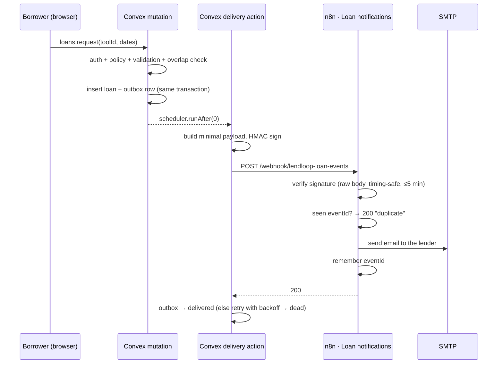

### Flow 2: daily overdue reminders (n8n → Convex)

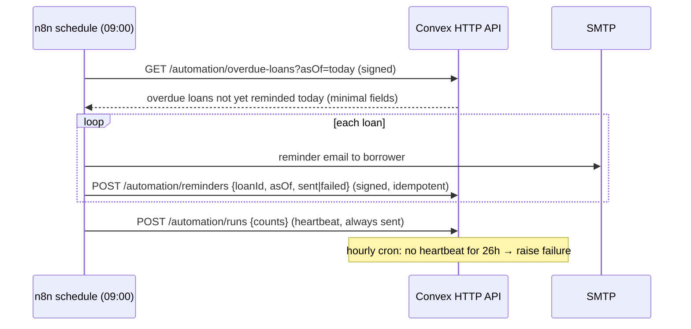

---

## Security and data minimization

### Authentication and authorization

- **Identity is derived, never accepted.** No function takes a user id for authorization. The caller is resolved from `ctx.auth.getUserIdentity().tokenIdentifier`, and ownership fields (`ownerId`, `borrowerId`) are set server-side.
- **Roles live in Convex, not in a client-editable Clerk field.** Admins are bootstrapped from `ADMIN_EMAILS`, but only when Clerk reports the email as **verified** (tested). After that, roles change only through `admin.setRole`, which is audited and blocks self-demotion so the last admin can't be locked out.
- **The access matrix** (enforced in `convex/lib/policy.ts`, tested in `policy.test.ts` and through the real API in `rbac.test.ts`):

  | | owner / lender | borrower | other user | admin |
  | --- | :-: | :-: | :-: | :-: |
  | edit tool | ✔ | – | ✘ | ✘ |
  | delete / remove tool | ✔ own | – | ✘ | ✔ any (audited) |
  | request to borrow | ✘ own tool | ✔ | ✔ | ✔ |
  | approve / decline | ✔ | ✘ | ✘ | ✘ |
  | cancel request | ✘ | ✔ | ✘ | ✘ |
  | mark returned | ✔ | ✘ | ✘ | ✔ |
  | view loan + timeline | ✔ | ✔ | ✘ | ✔ |

  Admins deliberately **cannot approve loans** on a lender's behalf. Moderation power shouldn't extend to committing someone else's property.
- **Input validation on the server**: Convex validators on every argument, length limits, real calendar dates (rejects `2026-02-31`), range rules (≤ 30 days, ≤ 90 days ahead, not in the past), and overlap checks inside the transaction. The UI mirrors these rules only for instant feedback.
- **Rate limits** (`@convex-dev/rate-limiter`, transactional): tool creation, borrow requests, and loan actions per user.
- **Web hardening**: Clerk-managed CSP (with Convex added to `connect-src`), `X-Frame-Options: DENY`, `nosniff`, strict referrer policy, HSTS, `Permissions-Policy`, no `X-Powered-By`.

### Data minimization: who sees what

| Audience | Sees | Never sees |
| --- | --- | --- |
| Anonymous visitor | tool **name + category** | owners, descriptions, availability, ids |
| Signed-in neighbor | tool details, owner **first name**, trusted badge, booked **date ranges** | other users' emails, who booked which dates |
| Loan counterpart | first name, dates, the borrower's note (lender only); **email only while the loan is approved**, so the two can arrange the hand-over | contact details before consent (pending) or after the loan is closed |
| Admin | names and emails for moderation | — |
| n8n (loan event) | recipient email + first name, counterpart first name, tool name, dates, status, deep link | descriptions, free-text notes, counterpart's email |
| n8n (overdue list) | borrower email + first name, lender first name, tool name, due date | everything else |

Free-text request messages are intentionally **not** sent to n8n or put in emails. The email links back to the app instead, which keeps user-written content out of third-party mail logs.

### Integration security (both directions)

| Concern | Decision |
| --- | --- |
| Authenticity | HMAC-SHA256 on every request in both directions, header `X-LendLoop-Signature: v1=<hex>` |
| Key separation | **Two keys.** Convex→n8n and n8n→Convex use different secrets, so a leaked n8n-side key can't forge events from Convex. |
| What's signed | Convex→n8n: `timestamp.rawBody`. n8n→Convex: `timestamp.METHOD.path?query.rawBody`, so a captured signature for `GET /overdue-loans` can't be replayed against `POST /reminders` or with a different `asOf`. |
| Raw bytes | n8n verifies the **raw request body** (`rawBody: true`), not re-serialized JSON. n8n sends the exact string it signed (`contentType: raw`). |
| Freshness | Timestamp must be within ±5 minutes. |
| Comparison | Constant-time (`crypto.timingSafeEqual` in n8n, an XOR loop in Convex). |
| Oracle resistance | Convex answers any verification failure with a generic `401`; the precise reason goes to logs only. |
| Scope limiting | `asOf` must be within a day of server time, bodies ≤ 64 KB, every field validated with zod. |
| Secrets | Env vars + n8n's encrypted credential store only. The SMTP credential is built inside the container and imported encrypted, so plaintext never touches the host. |

A per-request nonce store was considered and **rejected**. n8n's *Retry On Fail* resends the same signed request, so a nonce check would turn safe retries into failures. Writes are idempotent, so replaying one inside the 5-minute window is a no-op, and TLS protects the window in production.

---

## Automation: reliability and error handling

### Delivery guarantees

**Convex → n8n uses a transactional outbox.** The outbox row is written in the *same transaction* as the state change, so there is no "saved the loan but never notified" gap. A scheduled action delivers it:

| Response | Outcome |
| --- | --- |
| 2xx | `delivered` |
| network error, timeout, 408, 429, 5xx | `retrying`: backoff 10 s → 30 s → 2 min → 10 min → 30 min (±20 % jitter) |
| other 4xx (e.g. signature rejected) | `dead` immediately; retrying won't fix it |
| 6 attempts | `dead` |

Dead events show up on *Admin → Automation* with the last error and a **Retry** button. A retry reuses the same `eventId`, so n8n dedupes it if the first attempt did arrive. Delivery is **at-least-once with idempotent consumers**.

**Idempotency, end to end**

| Write | Key | Effect of a retry or re-run |
| --- | --- | --- |
| Loan event in n8n | `eventId`, kept in workflow static data (saved only when the execution succeeds, pruned after 7 days) | `200 {"status":"duplicate"}`, no second email |
| Reminder write-back | `loanId:asOf` | `created` → `duplicate`; `sent` is terminal (a late `failed` can't downgrade it), `failed → sent` is allowed |
| Overdue list | excludes loans already reminded for `asOf` | re-running the sweep the same day sends nothing new |
| Run heartbeat / failure report | n8n execution id | upsert, no duplicates |

### Nothing fails silently

| Failure | How it surfaces |
| --- | --- |
| n8n node fails after its retries | the **Error handler** workflow (set as `errorWorkflow` on both workflows) POSTs the failure to Convex and emails ops. It appears on *Admin → Automation* and in the loan's timeline. |
| n8n or SMTP down during a loan event | the webhook returns 5xx or times out, so Convex retries with backoff. After the last attempt the event is `dead`, shown in admin and on the loan ("Couldn't notify… admins alerted"). |
| One reminder fails to send | that item continues (`onError: continueRegularOutput`) and is written back as `failed` with the error. Other borrowers still get theirs, and the run summary counts the failure. |
| **Daily job never runs** (n8n down, workflow unpublished) | an error workflow can't catch this. A Convex **watchdog cron** checks the heartbeat hourly and raises a failure if there's been no sweep for 26 h. |
| Convex rejects a signature | a generic 401 to the caller, the precise reason in Convex logs; the n8n node fails and the error workflow fires. |
| Error workflow itself fails to reach Convex | it still emails ops (`continueRegularOutput` on the report step). |

All of these were exercised against the running stack: stopping Mailpit mid-flow produced two reported failures, the outbox retried, and the event was delivered on attempt 4 once SMTP came back.

---

## Testing

```bash
npm run check   # tsc (app + convex) → eslint → vitest
```

34 tests in `convex/` with **convex-test** (an in-memory Convex) and Vitest:

- **`lib/policy.test.ts`**: the full access matrix and state guards; date rules (calendar validity, inclusive overlap, timezone slack).
- **`rbac.test.ts`**: the same rules through the real public API as five identities: public data exposure, owner-only edits, admin removal (audited), self-borrow, lender-only approval, participant-only timelines, contact details shared only while approved, overlap auto-decline and double-booking prevention, one outbox event per state change, verified-email admin bootstrap.
- **`automation.test.ts`**: HTTP signature rejection (missing, wrong key, stale, query-swapped), payload minimization (asserts the private note, the description and the counterpart's email are absent), idempotent write-backs, the `sent`-is-terminal rule, outbound signing verified against an independent recomputation, retry vs dead classification, and giving up after `MAX_ATTEMPTS`.

The n8n workflows were tested end to end against the local stack (signed delivery, duplicate, tampered and stale requests, SMTP outage and recovery, idempotent re-runs).

---

## Project layout

```
convex/
  schema.ts               tables + indexes
  convex.config.ts        typed env vars, rate-limiter component
  lib/functions.ts        userQuery / userMutation / adminQuery / adminMutation
  lib/policy.ts           the authorization rules (pure functions)
  lib/outbox.ts           publishLoanEvent: write-in-transaction + schedule
  tools.ts, loans.ts      public API
  admin.ts                admin-only API
  users.ts                profile sync from the Clerk JWT, admin bootstrap
  automation/signing.ts   HMAC scheme shared by both directions
  automation/delivery.ts  outbox delivery action (retry/backoff/dead-letter)
  automation/inbound.ts   idempotent write-backs used by http.ts
  automation/watchdog.ts  "the daily job stopped running" detector
  http.ts                 signed /automation/* endpoints
  crons.ts, seed.ts
  *.test.ts
n8n/
  docker-compose.yml      n8n + Postgres + Mailpit
  workflows/*.json        exported workflows (no secrets)
scripts/
  setup-secrets.mjs       generate keys → n8n/.env + Convex env
  n8n-setup.mjs           import credential + workflows, publish, export
src/
  app/page.tsx            public landing page
  app/(app)/…             signed-in pages (board, tools, me/*, admin)
  components/…            UI (no component library; small primitives in components/ui)
  proxy.ts                Clerk middleware + CSP
```

---

## Running this in production

What I would change before real users touch it:

1. **Deployments**: Convex production deployment, Vercel for Next.js, Clerk production instance. Run n8n on a managed container service (ECS Fargate or Fly) or n8n Cloud, behind TLS. n8n's webhook URL must be HTTPS and public (no tunnels).
2. **n8n hardening**: queue mode (Redis + workers) so a slow SMTP doesn't block the webhook process; **external task runners** for Code-node isolation (2.x recommends this). Restrict `N8N_BLOCK_ENV_ACCESS_IN_NODE` to the specific env vars needed, or move signing keys into a secrets backend (Vault, AWS Secrets Manager) through n8n's external secrets. Put the editor behind SSO/VPN and expose only `/webhook/*` publicly. Back up Postgres and the encryption key.
3. **Secrets**: rotate the signing keys periodically with a **dual-key window**: accept `v1` signatures from the current and previous key during rollout (`kid` header). Store them in a secrets manager rather than `.env` files.
4. **Durable dedupe in n8n**: workflow static data is fine for one instance, but with queue mode and multiple workers, move the "seen eventIds" set to Redis/Postgres (or ask Convex, which already knows delivery state).
5. **Email**: SES, Postmark or Resend with SPF/DKIM/DMARC, bounce and complaint handling, and an unsubscribe and notification-preferences page. Templates move out of Code nodes into the provider's templating.
6. **Observability**: Convex log streams to Datadog or Axiom; Sentry in Next.js and for Convex function errors; alerts on `outbox.dead > 0`, on watchdog failures, and on n8n error executions (a Slack or PagerDuty channel instead of an email).
7. **User sync**: add a Clerk `user.updated` / `user.deleted` webhook (Svix-verified) so profile changes and **account deletion** propagate immediately (GDPR erasure: anonymize the user and keep loan rows for the counterpart's history).
8. **Data retention**: TTL for `outbox`, `reminders` and `auditLog`, export of the audit log to immutable storage, and an n8n execution data retention policy, since executions contain recipient emails.
9. **Scale**: the board query is bounded (`take(200)`); for a big neighborhood, paginate, add a search index (`withSearchIndex`), and denormalize availability into the tool row on loan changes instead of computing it per read.
10. **Product**: a real calendar picker, in-app messaging instead of off-app contact, borrower ratings feeding the Trusted Lender decision, and neighborhood scoping (multi-tenant `communityId` on every row and in every policy check).

---

## Trade-offs and known limitations

- **Dates are calendar dates without a timezone.** The server allows one day of slack on "today" for users west of UTC, and the sweep's `asOf` comes from n8n's configured timezone. A multi-region deployment would store a community timezone.
- **"Sent but not recorded" window.** If n8n emails a reminder and then can't write it back (Convex unreachable after retries), the error workflow reports it, but a *manual* re-run the same day would send that one reminder again. A claim-before-send step (`status: sending`) would close this, at the cost of another round trip per loan.
- **Re-importing workflows** (`npm run n8n:setup`) resets the n8n-side dedupe set. Convex still won't re-deliver anything already `delivered`.
- **Local-only email.** Mailpit catches everything, so no real email goes out in development.

---

*Built with AI assistance (Claude Code). I reviewed every design decision in this README and can explain any of them.*
